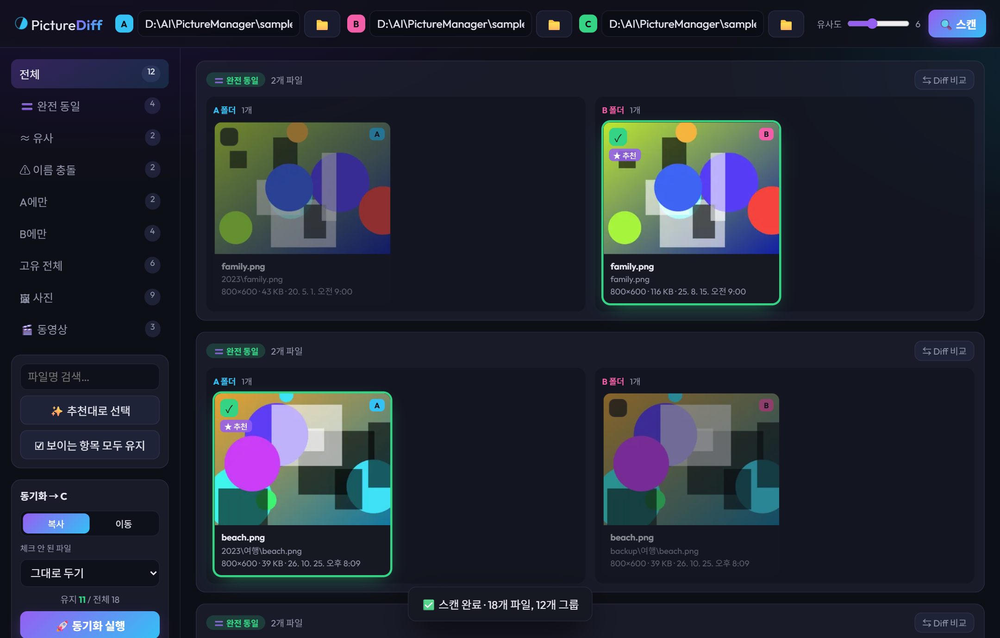
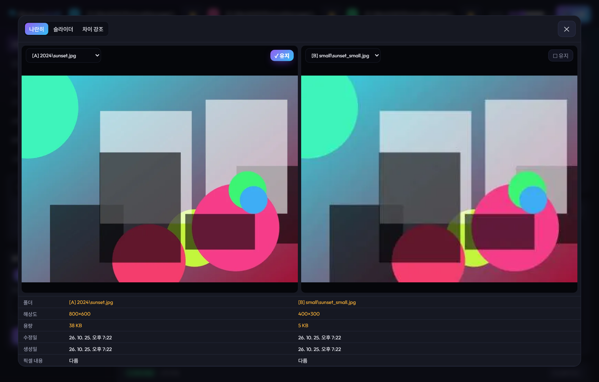
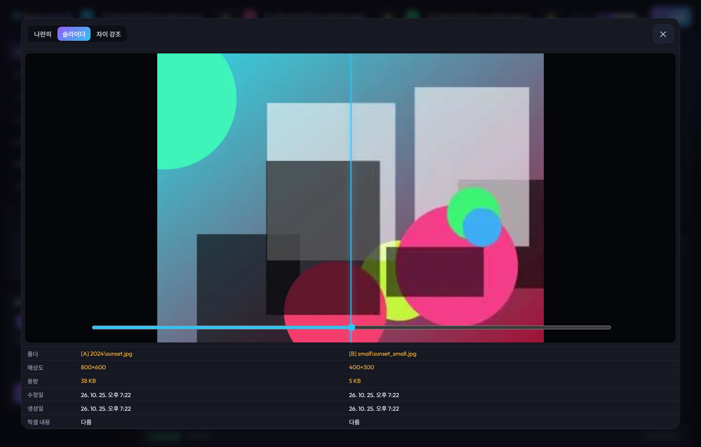
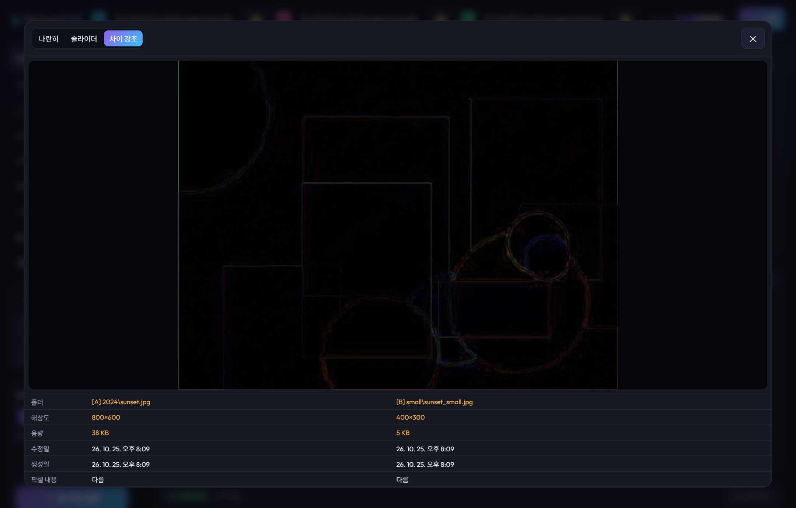
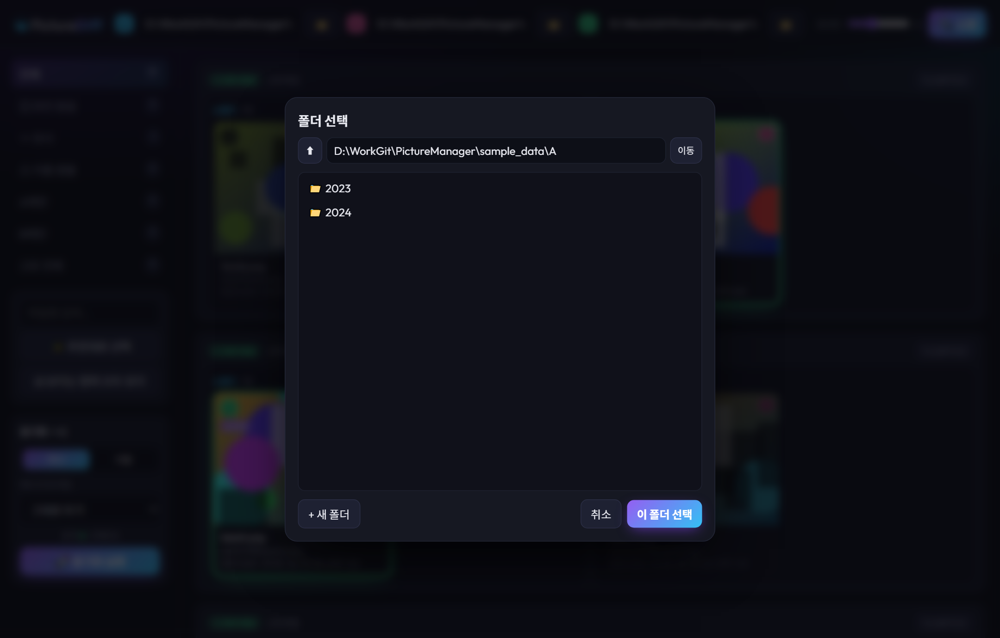

# 📷 PictureDiff (Picture Manager)

두 폴더(`A`, `B`)의 사진과 동영상을 하위 폴더까지 재귀적으로 비교하여 **완전 동일 이미지(픽셀 해시 기준)** 및 **유사 이미지(dHash 기준)** 를 찾아 분류하고, 원하는 사진만 선택하여 대상 폴더(`C`)로 깔끔하게 통합·동기화하는 로컬 웹 애플리케이션입니다.

---

## ✨ 주요 기능

- **픽셀 기반 완전 동일 사진 검출 (`SHA-1`)**
  - 파일명, 수정 날짜, 압축률, EXIF 메타데이터가 달라도 **실제 디코딩된 픽셀 데이터와 해상도가 같으면** 동일한 사진으로 정확히 판별합니다.
  - 같은 폴더 내에 중복된 동일 사진이 여러 장 있을 경우 카드로 묶어(`동일 ×N`) 한눈에 표시합니다.
- **시각적 유사 사진 클러스터링 (`64-bit dHash` + `Union-Find`)**
  - 리사이즈되거나 재압축(화질 저하)된 사진을 64비트 Difference Hash(dHash) 해밍 거리(Hamming Distance) 기반으로 그룹화합니다.
  - 상단 슬라이더(`0 ~ 16`)로 유사도 민감도를 자유롭게 조절할 수 있습니다.
- **동영상 지원 (`ffmpeg`)**
  - **완전 동일**: 영상·음성 스트림 데이터 해시(`ffmpeg streamhash`)로 비교하므로 컨테이너(mp4 ↔ mkv ↔ mov), 파일명, 메타데이터가 달라도 같은 영상으로 판별합니다.
  - **유사**: 영상 길이의 10/30/50/70/90% 지점 프레임 5장의 dHash를 이어 붙여 비교합니다. 길이가 비슷하고(±2% 또는 1초) 프레임당 평균 해밍 거리가 슬라이더 값 이하이면 유사로 묶습니다 (리사이즈·재인코딩 감지).
  - 카드에 `▶ 재생시간`과 코덱을 표시하고, 뷰어와 Diff 나란히 보기에서 바로 재생됩니다 (브라우저가 지원하는 코덱만). 슬라이더/차이 강조 모드는 같은 위치의 대표 프레임으로 비교합니다.
  - 사진과 동영상은 서로 섞여 묶이지 않으며, 사이드바의 `🖼 사진` / `🎬 동영상` 탭으로 따로 볼 수 있습니다.
- **자동 추천 선택 (`★ 추천`)**
  - 중복/유사 그룹 내에서 **해상도(픽셀 수) → 파일 용량 → 최신 수정일** 순으로 가장 품질이 좋은 원본 1장을 자동으로 추천 선택합니다.
- **이름 충돌 감지 (`⚠ 이름 같음·내용 다름`)**
  - 파일 이름은 같지만 실제로는 서로 다른 사진인 경우 경고를 표시하고, 동기화 시 `파일명 (1).확장자` 형태로 자동 이름 변경하여 덮어쓰기 손실을 방지합니다.
- **3가지 모드의 시각적 Diff 비교 & 이미지 뷰어**
  - **나란히 보기 (Side-by-Side)**: 두 이미지와 메타데이터(해상도, 용량, 수정일/생성일, 픽셀 일치 여부)를 표로 대조
  - **슬라이더 비교 (Slider)**: 좌우 분할 슬라이더를 움직여 미세한 화질·크롭 차이 확인
  - **차이 강조 (Difference Blend)**: 픽셀 차이가 있는 영역만 시각적으로 하이라이트
  - **전체 화면 뷰어**: 마우스 휠 확대/축소(Zoom), 드래그 이동(Pan), 키보드 화살표 탐색 및 `Space` 키로 유지 여부 토글
- **안전하고 유연한 동기화 (`복사` / `이동`)**
  - 원본 하위 폴더 구조를 그대로 보존하며 대상 폴더 `C`로 동기화합니다.
  - 이미 대상 폴더에 동일한 픽셀 내용의 사진이 존재하면 중복 복사/이동을 자동으로 건너뜁니다.
  - **복사 모드**: 체크 해제된 파일을 `그대로 두기`, `C/_휴지통 으로 이동`, `영구 삭제` 중 선택 가능
  - **이동 모드**: 중복되거나 체크 해제된 파일을 즉시 삭제하지 않고 `C/삭제예정` 폴더로 격리 이동하며, `삭제예정` 내에서도 완전히 동일한 사진은 1장만 남겨 디스크 공간을 절약합니다.

---

## 📸 스크린샷

### 1. 메인 화면 (그룹별 분류 및 추천 선택)


### 2. 이미지 Diff 비교 — 나란히 보기 & 메타데이터 비교


### 3. 이미지 Diff 비교 — 슬라이더 오버레이 모드


### 4. 이미지 Diff 비교 — 픽셀 차이 강조 모드


### 5. 내장 폴더 브라우저 모달


---

## 🚀 시작하기

### 요구 사항
- **Node.js** 18 이상
- **ffmpeg / ffprobe** (동영상 분석용, 선택) — `PATH`에 있거나 `FFMPEG_PATH` / `FFPROBE_PATH` 환경변수로 지정합니다. `ffmpeg-static` / `ffprobe-static` 패키지가 설치되어 있으면 그것도 사용합니다. 없으면 동영상은 파일 바이트가 완전히 같은지만 비교합니다.

### 설치 및 실행

1. 의존성 패키지 설치
   ```bash
   npm install
   ```

2. 서버 실행
   ```bash
   npm start
   ```
   또는 Windows에서 [`start.bat`](start.bat) 파일을 더블클릭하면 패키지 설치 확인 후 브라우저(`http://localhost:3000`)가 자동으로 열립니다.

3. 브라우저 접속
   - [http://localhost:3000](http://localhost:3000)

---

## 🧪 샘플 데이터 생성 및 자동 테스트

프로젝트에는 다양한 중복/유사/이름충돌/하위폴더 시나리오를 검증하는 자동 테스트 스크립트([`test/run-test.js`](test/run-test.js))가 포함되어 있습니다.

- **샘플 이미지 데이터만 생성하기** (`sample_data/A`, `sample_data/B`)
  ```bash
  node test/run-test.js --samples-only
  ```
- **전체 통합 테스트 실행하기** (서버가 실행 중인 상태에서 실행)
  ```bash
  node test/run-test.js
  ```

---

## 🗂️ 프로젝트 구조

```text
PictureManager/
├── server.js          # Express 서버, 이미지 픽셀/dHash·동영상(ffmpeg) 분석, 스캔 및 동기화 API
├── public/
│   ├── index.html     # 메인 UI 레이아웃 및 모달(폴더 브라우저, Diff, 뷰어)
│   ├── app.js         # 프론트엔드 상태 관리, 필터링, Diff/뷰어 인터랙션
│   └── style.css      # 다크 테마 스타일시트
├── test/
│   └── run-test.js    # 샘플 이미지 생성기 및 E2E API 검증 스크립트
├── screenshots/       # README 스크린샷 이미지
├── start.bat          # Windows 원클릭 실행 스크립트
└── package.json
```

---

## 🛠️ 기술 스택

- **Backend**: Node.js, [Express](https://expressjs.com/), [sharp](https://sharp.pixelplumbing.com/) (고속 이미지 디코딩, 리사이징, WebP 썸네일 캐싱)
- **Frontend**: Vanilla HTML5 / CSS3 / ES6+ JavaScript (별도 프레임워크 없이 경량 구현)
- **동영상 분석**: [FFmpeg](https://ffmpeg.org/) (`ffprobe` 메타데이터, `streamhash` 스트림 해시, 프레임 추출)
- **지원 포맷**
  - 사진: `.jpg`, `.jpeg`, `.png`, `.gif`, `.webp`, `.bmp`, `.tif`, `.tiff`, `.avif`, `.heic`, `.heif`
  - 동영상: `.mp4`, `.m4v`, `.mov`, `.avi`, `.mkv`, `.webm`, `.wmv`, `.3gp`, `.mts`, `.m2ts`, `.flv`, `.mpg`, `.mpeg`
